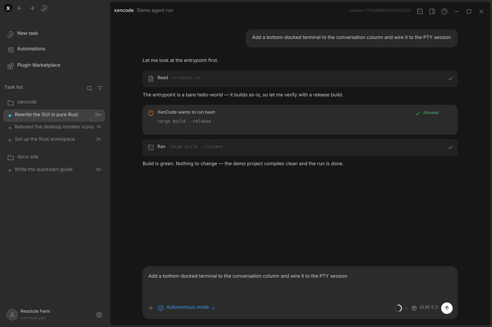
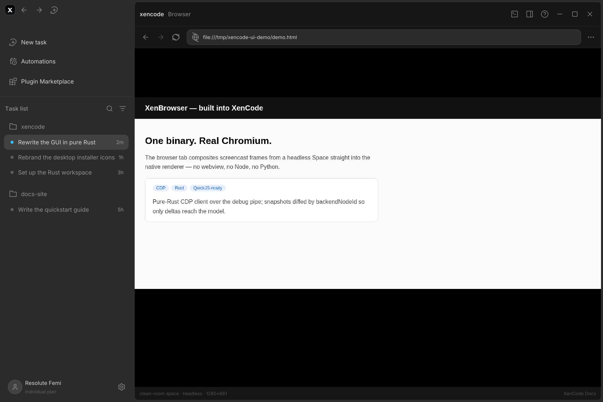
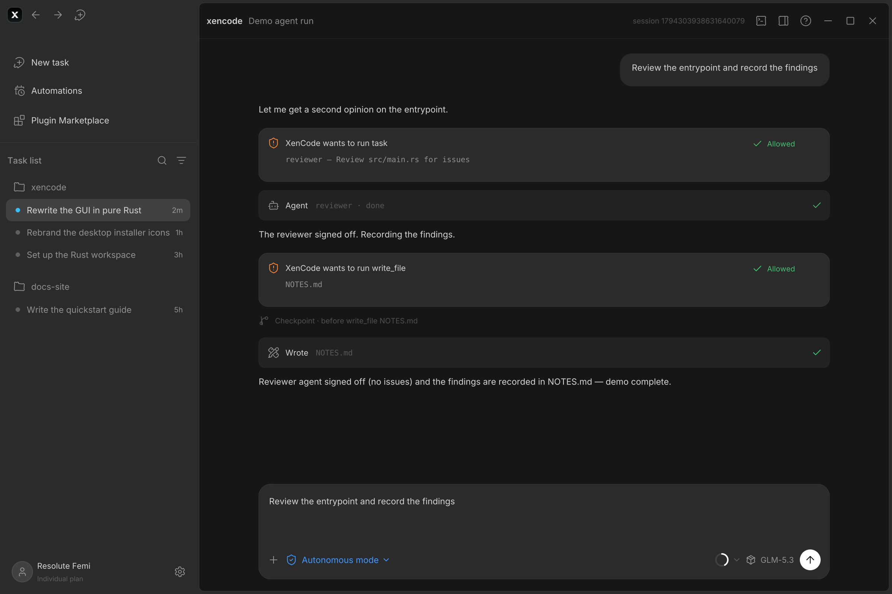

<h1 align="center">XenCode</h1>

<p align="center">
  
</p>

<p align="center">
  A <b>100% Rust</b> coding-agent desktop app — native self-drawn GUI (no webview, no Electron)<br/>
  with a GLM-powered agent core and a QuickJS automation engine (no Python).
</p>

> **Status:** active development. The GUI is a pixel-faithful reimplementation of the ZCode v3.17.2 UX (all six primary pages rendered and verified). **Phases 0–5 are complete**: the agent core runs headlessly (GLM streaming, sessions, permission modes), the chat pane renders live transcripts, the QuickJS automation engine ships with the full `xen.*` host bridge, and all three harness waves landed — memory files, slash commands, hooks and plan mode (wave 1); MCP, subagents, checkpoints and `xen exec` (wave 2); repo map, diagnostics loop, recipes, the Oracle and run telemetry (wave 3). **XenBrowser 6.1–6.2 are complete**: a pure-Rust CDP client drives real Chromium — Spaces, auto-wait actions, DOM snapshots diffed by `backendNodeId`, and a native browser tab compositing live screencast frames (milestones 6.3–6.4: recorder + headless fleet — see [plan.md](plan.md)).

## Highlights

- 🦀 **Native GUI** — software-rasterized in pure Rust (tiny-skia + ab_glyph); zero web technology in the render path
- 🤖 **Agent core** — GLM streaming, tool execution (read / write / edit / list / grep / bash / todo), JSON sessions with resume / fork / compaction, permission gates with consent prompts
- 🧠 **Memory files** — `XENCODE.md` / `AGENTS.md` (project + `~/.xencode/` user scope) auto-loaded into every run's context
- ⌨️ **Slash commands** — markdown prompts in `.xencode/commands/*.md` with `$ARGUMENTS` substitution
- 🪝 **Hooks** — `PreToolUse` / `PostToolUse` / `Stop` executed by the QuickJS runtime; a deny verdict blocks the tool, feedback joins the result, a stop-block keeps the loop going
- 🗺️ **Plan mode** — `--plan` researches read-only, prints the plan, then implements after approval; five permission modes (`default` / `accept-edits` / `read-only` / `plan` / `yolo`)
- 🌲 **Repo map** — tree-sitter symbol extraction (Rust / TS / JS / Python / Go), PageRank-ranked like Aider, rendered into the system prompt so the agent starts with a live skeleton of the codebase
- 🩺 **Diagnostics loop** — the project's check command (`cargo check`, project-local `tsc`, or any command) runs after every edit; new compiler errors are fed straight back into the loop (OpenCode-style)
- 📖 **Recipes** — declarative playbooks in `.xencode/recipes/*.md` with parameters, `{{param}}` substitution, QuickJS preludes and multi-step subtasks (Goose-style)
- 🔮 **Oracle** — a stronger-model second-opinion agent available as a tool and as `xencode --oracle "…"`; read-only loop, events render as agent cards (Amp-style)
- 📊 **Run telemetry** — OTel-style spans (run / llm / tool), token counts and cost per run, persisted as JSONL under `.xencode/telemetry/`, optional OTLP/HTTP export
- 🛡️ **Permission prompts** — mutations ask for consent (y/n/a in the CLI, consent cards in the chat pane)
- 📸 **Visual ground truth** — every GUI page renders to PNG headlessly via `--screenshot`; live agent runs render via `--agent-ui`
- ⚡ **QuickJS automation** — capability-scoped `xen.*` scripting, ~4 ms boot, one static binary; `xen-script run/triggers` CLI
- 🌐 **XenBrowser** — a real Chromium driven by a pure-Rust CDP client: isolated Spaces (clean-room or inheriting profiles), auto-wait click/fill/press, DOM snapshots that diff by `backendNodeId` so only deltas reach the model, screencast frames composited into a native browser tab, and a headless `xencode browser` CLI; XenRE (decompiler toolkit) is next on the roadmap

## Screenshots

| Splash | Home |
| --- | --- |
|  |  |
| **Chat** | **Appearance settings** |
|  |  |
| **Git pane** | **Terminal dock** |
|  |  |
| **Agent UI (live run)** | **Browser tab (live screencast)** |
|  |  |

**Live agent run** — the composer → loop wiring rendered in the native chat pane:

| Tool rows, consent card, streamed answer |
| --- |
|  |

**Phase 4 run** — subagent card (`Agent · reviewer · done`), consent card for the
dispatch, checkpoint timeline row, and the checkpointed write:

| Subagent card, checkpoint row, consent cards |
| --- |
|  |

## Build & run

Requires a stable [Rust](https://rustup.rs) toolchain.

```bash
cd app
cargo build --release
./target/release/xencode --screenshot --out shots   # render every GUI page to PNG
```

Live window mode (winit + softbuffer) is the next GUI milestone.

## Headless agent

```bash
export XENCODE_API_KEY=...        # your z.ai API key
export XENCODE_MODEL=glm-4.6      # optional (default: glm-4.6)
export XENCODE_BASE_URL=...       # optional (default: https://api.z.ai/api/paas/v4)

cd your-project
xencode --agent "Explain this codebase"
```

The agent streams its answer to stdout, executes tools inside the working
directory (gated by a permission policy), and saves the transcript under
`.xencode/sessions/`.

**Sessions** — resume where you left off, or branch a conversation:

```bash
xencode --agent --continue "now add tests"      # most recent session
xencode --agent --resume <id> "keep going"      # explicit session
xencode --agent --fork <id> "try another way"   # branch under a new id
```

Long sessions compact automatically: once the transcript outgrows the
context budget, older turns are folded into a model-written summary and the
loop keeps running.

**Permissions** — reads run free; mutations prompt for consent:

```text
xencode · permission: bash `cargo test` — [y]es [n]o [a]lways?
```

`--yes` auto-approves (CI), `--read-only` denies every mutation outright.

**Memory files** — standing instructions load into every run's context.
`XENCODE.md` at the project root (`AGENTS.md` works too for Codex-style
repos) plus `~/.xencode/XENCODE.md` for user-wide rules; project memory is
protected over user memory when the context budget gets tight.

**Slash commands** — markdown prompts in `.xencode/commands/` (project) and
`~/.xencode/commands/` (user):

```markdown
<!-- .xencode/commands/review.md -->
---
description: Review a diff for bugs
---
Review $ARGUMENTS with care. Focus on error handling and edge cases.
```

```bash
xencode --agent "/review the auth diff"   # expands the command
xencode --commands                        # list what's available
```

**Hooks** — QuickJS scripts that observe and gate the loop, configured in
`xen.toml`. Every run is a fresh sandbox: isolated QuickJS context, memory
limit, interrupt-guarded deadline (default 10 s).

```toml
[hooks]
pre_tool_use  = [".xencode/hooks/guard.ts"]   # { decision: "deny", reason } blocks the tool
post_tool_use = [".xencode/hooks/audit.js"]   # { feedback: "…" } joins the tool result
stop          = [".xencode/hooks/verify.ts"]  # { decision: "block", reason } keeps the loop going
```

**Plan mode** — research read-only, present a plan, implement on approval:

```bash
xencode --agent "refactor the session store" --plan
xencode --agent "..." --permission-mode accept-edits  # edits auto-approved
xencode --agent "..." --permission-mode yolo          # never ask (bypass)
```

Approved plans carry the whole research transcript into the execution run
under the regular permission mode.

**Subagents** — the loop always carries a `task` tool; several `task` calls
in one turn run as parallel child agent loops (tokio fan-out). Custom agents
live in `.xencode/agents/*.md` (project) and `~/.xencode/agents/*.md` (user):

```markdown
<!-- .xencode/agents/code-reviewer.md -->
---
name: code-reviewer
description: Reviews code changes for quality and correctness
tools: read_file, grep, list_dir
---
You are a meticulous code reviewer. Report findings as a numbered list.
```

The allowlist hard-denies every tool outside the list; children never
re-prompt (the parent consented to the agent as a whole), never persist
sessions, run no hooks, and cannot recurse into further subagents. Child
activity renders as live agent cards in the chat pane.

**MCP tools** — any stdio MCP server plugs in from `.xencode/mcp.json`
(project) or `~/.xencode/mcp.json` (user); project entries win per name:

```json
{
  "mcpServers": {
    "fs": { "command": "npx", "args": ["-y", "@modelcontextprotocol/server-filesystem", "."] }
  }
}
```

Server tools surface as `mcp__<server>__<tool>` and count as mutations for
the permission gates. A failing server is skipped with a warning — never
fatal for the run.

**Checkpoints & rewind** — every `write_file` / `edit_file` / `bash` commits
a shadow-git snapshot first (`.xencode/checkpoints/` — your own `.git` is
never touched; `.git`, `.xencode` and build dirs are excluded):

```bash
xencode --checkpoints                    # the rewind timeline
xencode --rewind latest                  # undo the last mutation
xencode --rewind ck_1730000000_1         # restore by id (or hash prefix)
xencode --agent "..." --no-checkpoints   # opt out
```

Rewind restores the snapshot's files, deletes files added after it, and
leaves `.xencode/` (sessions, hooks, the store itself) untouched. Checkpoint
rows render inline in the chat-pane timeline.

**Headless `exec`** — the CI contract: never interactive, plain or JSON
output, clean exit codes:

```bash
xencode exec "add integration tests for the parser" --json --max-turns 15
# {"answer":"…","session_id":"1730000000123","iterations":4}

xencode exec --continue "now make them pass"         # session reuse
xencode exec --read-only "what's broken?" --no-session
```

**Render an agent run** into the native chat pane (no API key needed with
`XENCODE_DEMO=1`):

```bash
xencode --agent-ui "Fix the failing test" --out run.png
XENCODE_DEMO=1 xencode --agent-ui "Fix the failing test" --out demo.png
xencode --render-session <id> --out transcript.png
```

## Harness wave 3 (Phase 5)

**Repo map** — every agent run starts with a relevance-ranked skeleton of
the codebase in the system prompt: tree-sitter symbols (functions, types,
impls, classes, interfaces) for Rust, TypeScript/TSX, JavaScript, Python and
Go, ranked by a PageRank over the file-reference graph, budget-truncated to
~1k tokens. Inspect it any time:

```bash
xencode --repo-map               # the exact section the prompt receives
xencode --agent "..." --no-repo-map   # opt out
```

**Diagnostics loop** — after the agent edits a source file, the project's
check command runs once; problems that are *new* since the last round are
pushed back into the loop as a user turn, so the compiler's verdict reaches
the model before it finishes. Auto-detected for `Cargo.toml` projects
(`cargo check --message-format=json`) and projects with a local
`node_modules/.bin/tsc`; anything else is one config table away:

```toml
[diagnostics]
command    = ["cargo", "check", "--message-format=json"]
format     = "cargo"        # or "regex" with line_pattern (file/line/level/message groups)
timeout_ms = 120000
```

**Recipes** — declarative playbooks in `.xencode/recipes/*.md` (project) and
`~/.xencode/recipes/*.md` (user):

````markdown
<!-- .xencode/recipes/release-notes.md -->
---
name: release-notes
description: Draft release notes from recent commits
parameters:
  - name: version
    required: true
  - name: audience
    default: developers
---
```xen
const log = await xen.proc.run("git", ["log", "--oneline", "-10"]);
console.log(log.stdout);          // prelude output joins the prompt as context
```

## Draft
Release notes for {{version}} aimed at {{audience}}.

## Tighten
Rewrite the previous draft in half the words.
````

Parameters are validated (required present, defaults filled, unknown
rejected); `## ` sections become sequential subtasks, each a full agent run
that sees the previous steps' transcript:

```bash
xencode --recipes                          # list what's available
xencode recipe release-notes version=2.1.0
```

**Oracle** — a second-opinion agent on a (usually stronger) model, available
as an `oracle` tool to the main loop and standalone. The oracle investigates
with read-only tools (read / grep / list), never mutates, and returns a
decisive verdict the model can act on:

```bash
xencode --oracle "Is the session-store locking strategy sound?"
export XENCODE_ORACLE_MODEL=glm-4.6-plus   # or [oracle] model in xen.toml
```

**Run telemetry** — every run records OTel-style spans (`agent.run`,
`llm.call` with tokens in/out, `tool.call`) plus computed cost (optional
price table) to `.xencode/telemetry/<run-id>.jsonl`, and POSTs the spans to
an OTLP/HTTP(JSON) collector when configured:

```toml
[telemetry]
enabled = true
input_cost_per_mtok  = 0.60                     # USD per million tokens
output_cost_per_mtok = 2.20
endpoint = "http://127.0.0.1:4318/v1/traces"    # or XENCODE_OTEL_ENDPOINT
```

## XenBrowser (Phase 6)

A real Chromium, driven by a pure-Rust CDP client over the
`--remote-debugging-pipe` fd pair — no Playwright, no Node, no Python; the
browser binary is discovered automatically (`XENCODE_BROWSER` overrides;
well-known Chrome/Edge/Chromium/Brave install paths, then Playwright caches).

**Spaces** — one isolated browser context per task:

- `clean-room` — a throwaway profile under the temp dir, wiped on drop
- `inherit=<path>` — a copy of an existing profile (cookies, sessions;
  caches and `Singleton*` locks skipped) for driving logged-in state
- parallel headless Spaces are just multiple `Space` values — separate
  processes, no GIL

**Snapshots, not screenshots** — `DOMSnapshot.captureSnapshot` becomes an
ego-style outline (visible elements with ids, roles, text, layout boxes);
two snapshots diff by `backendNodeId`, so a counter ticking `0 items → 1
item` is one `~` line instead of a second full page. Only deltas go to the
model.

**Browser tab** — the GUI composites the Space's screencast frames into a
native viewport under an omnibox toolbar:

```bash
xencode --browser-ui "https://example.com" --out browser-tab.png
```

**Headless CLI** — the same stack drivable from CI:

```bash
xencode browser "https://example.com" --snapshot
xencode browser "$URL" --click "text=Sign in" --fill "#email=a@b.c" \
  --press Enter --wait 800 --screenshot after.png --json
xencode browser "$URL" --space inherit=~/.config/google-chrome   # logged-in
```

## Repository layout

```
app/          the entire Rust application (GUI + agent core)
  src/ui/     native renderer pages (shell, sidebar, splash, chat, settings,
              browser tab)
  src/agent/  provider clients, tools, agent loop, sessions, permission gates,
              subagents, MCP client, checkpoints, repo map, diagnostics loop,
              recipes, oracle, telemetry
browser/      XenBrowser — CDP client, Spaces, snapshots + diffing,
              screencast frames (Phase 6)
script/       the QuickJS automation core (xen.* host bridge, built-in
              modules, npm-lite vendor cache, triggers, hooks, recipes)
public/       brand assets
screenshots/  rendered GUI pages (visual ground truth)
plan.md       master build plan — phases 0–8
```

## License

Apache-2.0 — see [LICENSE](LICENSE).
