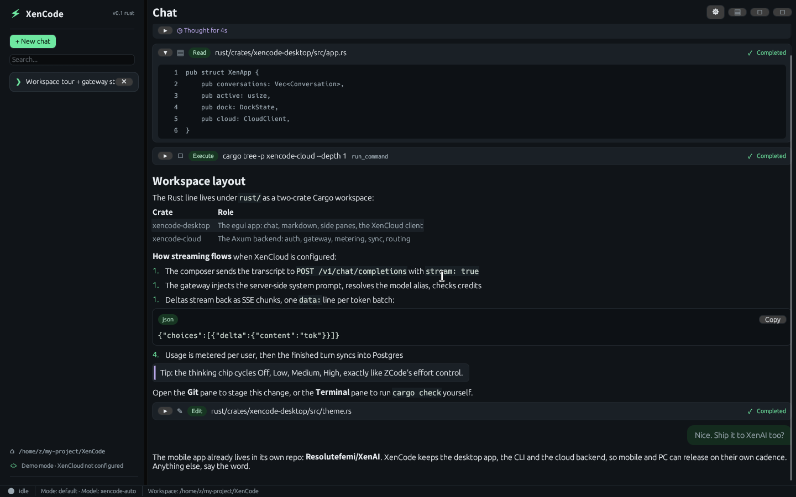
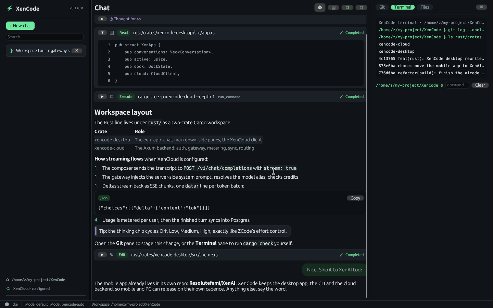
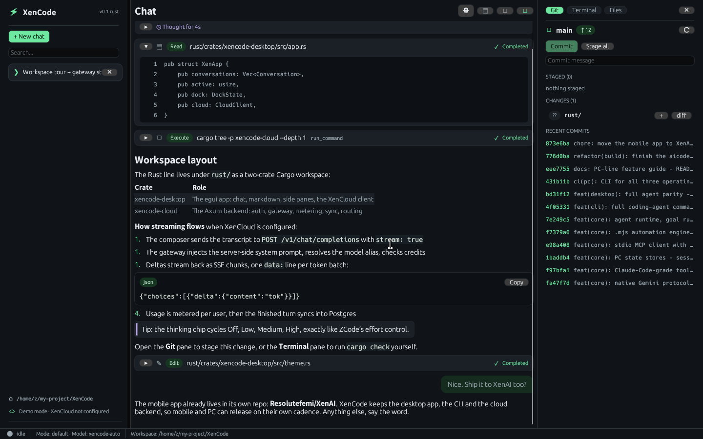
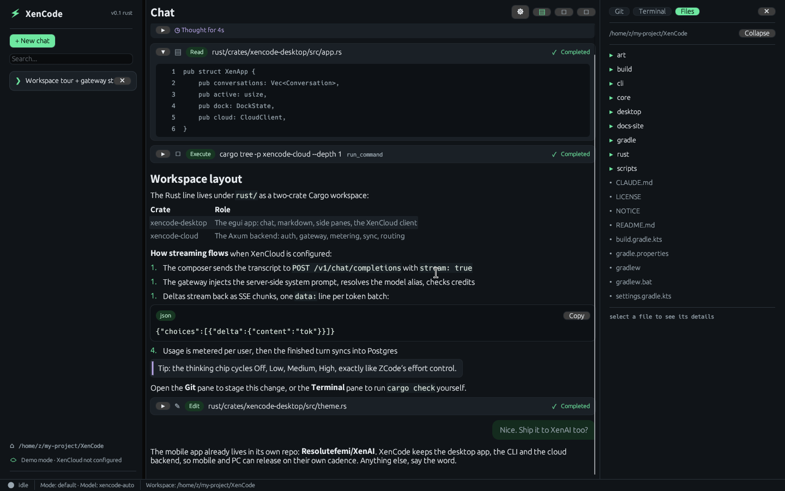

<div align="center">


# XenCode

**An AI coding workstation for the desktop and the terminal**

Compose Desktop app · Rust rewrite (egui) · CLI · XenCloud backend

<br/>

[](LICENSE)
[](https://github.com/Resolutefemi/XenCode/releases)
[](https://github.com/Resolutefemi/XenCode/releases)
[](https://github.com/Resolutefemi/XenCode/stargazers)
[](https://github.com/Resolutefemi/XenCode/forks)

[Quick Start](#quick-start) · [Features](#features) · [Docs](https://xencode.murk.top) · [Download](https://github.com/Resolutefemi/XenCode/releases/latest) · [Feedback](#feedback--contributing)

</div>

---

## Preview (Rust desktop)

<p>
  
  
  <br/><b>Streaming chat with markdown, tool rows and collapsible reasoning · XenCloud wired in, terminal pane open</b>
</p>

<p>
  
  
  
  <br/><b>Side panes: Git (stage/unstage/commit/diff/log) · Terminal (persistent cwd) · Files (workspace tree)</b>
</p>

---

## What is XenCode?

XenCode is the PC line of the XenCode project: a goal-driven AI coding agent that runs on every desktop and in every terminal, plus the cloud backend that powers it. The Android app now lives in its own repository, [Resolutefemi/XenAI](https://github.com/Resolutefemi/XenAI).

| Surface | Stack | What it is |
| :-- | :-- | :-- |
| **Desktop app** | Kotlin · Compose Desktop | Chat streaming, permission-gated tool loop, decision cards, Goal DAG board, telemetry, `.mjs` automation pane |
| **Rust rewrite** | Rust · egui | The same workstation experience rebuilt natively: ZCode-class chat UI, markdown + code-block rendering, and side panes for Git, terminal and files |
| **CLI** | Kotlin · Clikt | The full command surface in your shell: chat, exec, goals, checkpoints, MCP, XP |
| **XenCloud backend** | Rust · Axum · Postgres | Auth, LLM gateway with key protection, SSE streaming proxy, token metering and billing, session sync, prompt and model routing |

## Features

**Desktop (Windows / macOS / Linux)** — a Compose Desktop app with chat streaming, the permission-gated tool loop (read/write/edit/glob/grep/run + MCP), decision-card banners, a live Goal DAG board with the parallel swimlane runner, command-streak & spec-radar telemetry, the `.mjs` Automation pane, and provider management (OpenAI-compatible, native Anthropic, native Gemini).

**Rust rewrite (`rust/`)** — a native rebuild of the workstation experience:

- ZCode-style dark UI with the XenCode palette, sidebar, streaming chat and composer
- rich markdown rendering (headings, lists, tables, quotes, links, inline and fenced code blocks with language chips)
- tool-call blocks with status, and collapsible reasoning
- **side panes**: a Git pane (status, stage/unstage, commit, diff, log, branches), a terminal pane (command runner with persistent cwd and scrollback) and a files pane (workspace tree)
- XenCloud integration: sign in with a magic link or API key, stream completions through the gateway, sync conversations across machines

**XenCloud backend (`rust/crates/xencode-cloud`)** — an Axum service that sits between the desktop clients and the model providers:

- **Auth & user accounts** — magic-link login, API keys, revocable session tokens (never JWTs, so a leak can be killed server-side)
- **LLM gateway & key protection** — your master Anthropic / OpenAI / OpenRouter keys live only on the server; the desktop binary never sees them
- **Streaming proxy** — SSE forwarding with live token chunks, OpenAI-compatible request/response shapes, plus a native Anthropic passthrough
- **Token metering & billing** — per-user usage accounting, rate limits, credit balances and Stripe webhook integration
- **Conversation & session sync** — chat histories, project metadata and checkpoint snapshots in Postgres, resumable across machines
- **Prompt & agent routing** — server-side system prompts and a routing table that sends fast edits to small models and architecture work to the big ones, updated without shipping a new desktop build

**CLI** — a single Gradle-built distribution with the same brain and the full command surface:

```bash
./gradlew :cli:installDist
export PATH=$PATH:$(pwd)/cli/build/install/xencode/bin
xencode chat                                 # REPL with /help /compact /todo /checkpoint /decide ...
xencode exec "fix the failing test" --output-format json   # non-interactive
xencode config add --name zai --kind openai --base-url https://api.z.ai --api-key <KEY> --model glm-4.7
xencode goal add "Ship v1"                   # goal DAG at .xencode/GOAL_DAG.json
xencode goal run --parallel 4                # swimlanes: READY nodes run in isolated git worktrees
xencode checkpoint list && xencode session list
xencode mcp init && xencode mcp tools        # Model Context Protocol (stdio)
xencode run --example > .xencode/scripts/report.mjs && xencode run .xencode/scripts/report.mjs
xencode todo add "write release notes" && xencode decide && xencode events
xencode xp && xencode doctor                 # +50 XP per goal, streaks and levels
```

**Shared agent runtime** — both PC clients run the same core: any OpenAI-compatible endpoint, native Anthropic or native Gemini; a permission policy (read-only / default / yolo + `tool:`/`cmd:` rules, deny>ask>allow) with interactive decision cards; pre/post tool hooks; automatic git checkpoints before risky edits (Time-Machine restore); persisted & resumable sessions; context compaction; the shared TODO list; MCP servers over stdio; the embedded `.mjs` automation engine (`import { fs, ast, pty, git, sync } from "xencode:core"`); and an ndjson event stream (`.xencode/events.ndjson`) that keeps every surface in sync. Goals persist in the same `.xencode/GOAL_DAG.json` format as the Android app and XP uses the same curve (`100·n²`), so levels mean the same thing everywhere.

## Quick Start

```bash
git clone https://github.com/Resolutefemi/XenCode.git
cd XenCode

# Compose Desktop app + CLI (JDK 21 required)
./gradlew :desktop:run            # launch the Compose desktop app
./gradlew :cli:installDist        # CLI distribution → cli/build/install/xencode/bin

# Rust rewrite + XenCloud backend (stable Rust required)
cargo run --release -p xencode-desktop          # egui desktop app
cargo run --release -p xencode-cloud            # Axum backend (see rust/crates/xencode-cloud/README.md)
```

## Project Structure

```text
XenCode
├── core/               # Shared JVM core for the PC line (providers, goal DAG, XP, tools)
├── cli/                # XenCode CLI (Clikt; chat, goal, dag, xp, config, doctor)
├── desktop/            # XenCode Desktop (Compose Desktop; Windows/macOS/Linux)
├── rust/               # Rust workspace
│   └── crates/
│       ├── xencode-desktop/   # egui rewrite: chat UI, markdown, Git/terminal/files side panes
│       └── xencode-cloud/     # XenCloud Axum backend: auth, LLM gateway, metering, sync, routing
├── docs-site/          # Online documentation site source
└── scripts/            # Repo maintenance scripts
```

The mobile app (Android) lives in [Resolutefemi/XenAI](https://github.com/Resolutefemi/XenAI).

## Feedback & Contributing

- 🐞 **Bug reports**: file them in [Issues](https://github.com/Resolutefemi/XenCode/issues); please include steps to reproduce, OS, and provider to speed up triage
- 💡 **Feature suggestions**: want a new feature or improvement? Start the discussion in [Issues](https://github.com/Resolutefemi/XenCode/issues) first
- 🔧 **Code contributions**: [Pull Requests](https://github.com/Resolutefemi/XenCode/pulls) are welcome

## Acknowledgements

- [jieapi/XenCode](https://github.com/jieapi/xencode) — the original author's project, where this codebase started
- [OpenCode](https://github.com/anomalyco/opencode) — a terminal AI coding tool, an early inspiration for this project
- [Termux](https://github.com/termux/termux-app) — the terminal components used by the mobile app (now in XenAI)

## License

This project is open-sourced under [GPL-3.0](LICENSE); see [NOTICE](NOTICE) for third-party component copyright notices.
