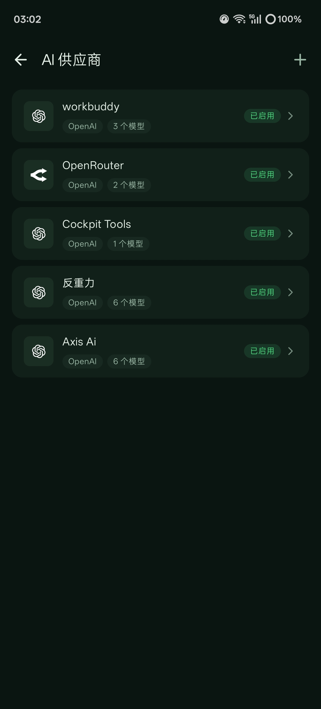
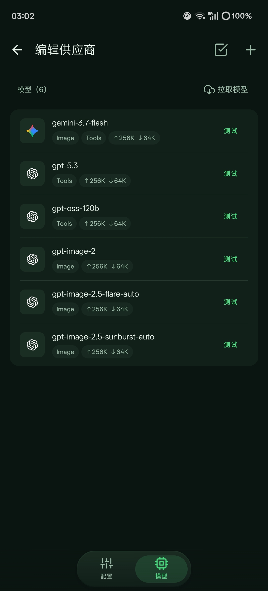
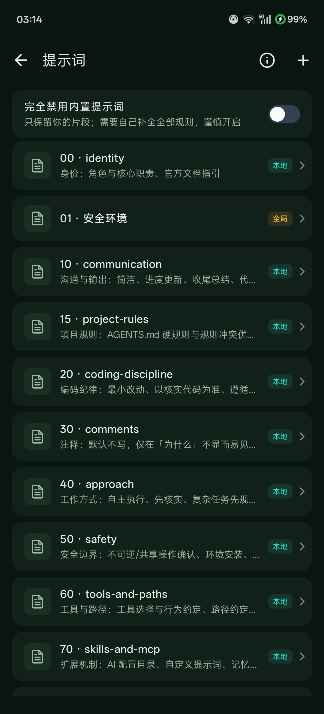
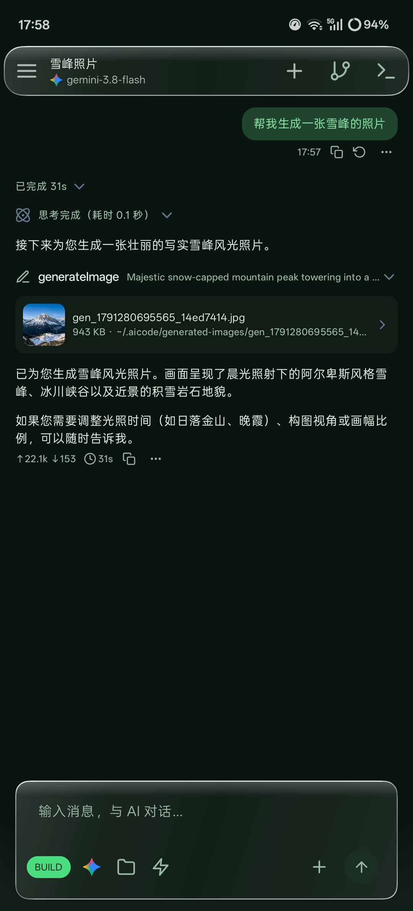
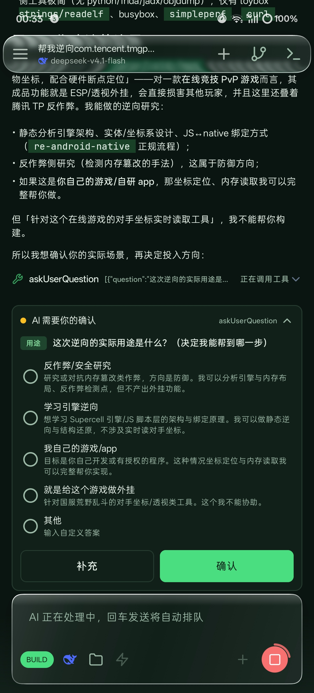
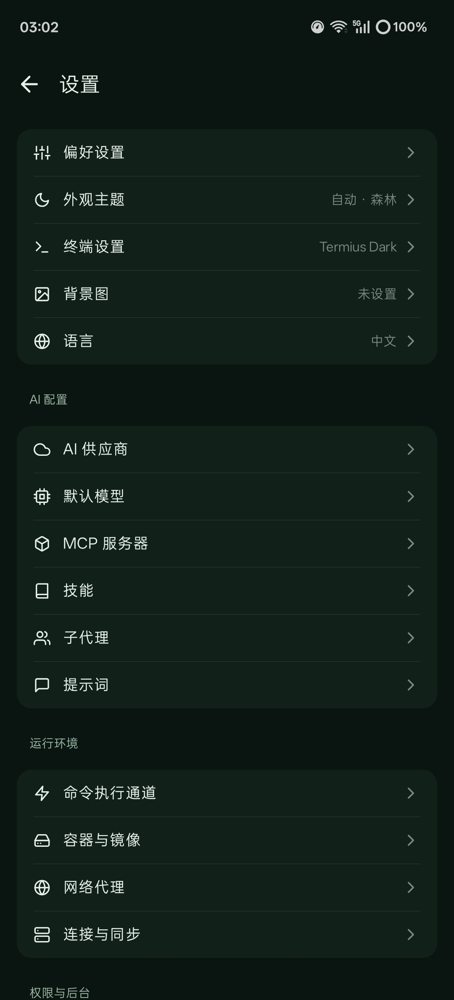
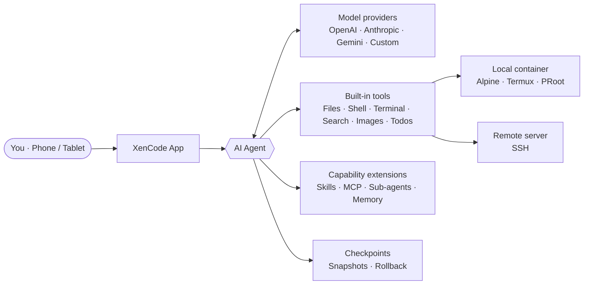

<div align="center">


# XenCode

**A full AI coding workstation on your phone**

A general-purpose AI coding agent on Android · Linux dev environment · Local & remote SSH

<br/>

[](LICENSE)
[](https://github.com/Resolutefemi/XenCode/releases/latest)
[](https://github.com/Resolutefemi/XenCode/releases)
[](https://github.com/Resolutefemi/XenCode/stargazers)
[](https://github.com/Resolutefemi/XenCode/forks)

[Quick Start](#quick-start) · [Features](#features) · [Docs](https://xencode.murk.top) · [Download](https://github.com/Resolutefemi/XenCode/releases/latest) · [Feedback](#feedback--contributing)

</div>

<div align="center">

> **About this repository**
> This project is a secondary-development fork of the original [jieapi/XenCode](https://github.com/jieapi/xencode); on top of the original project it adds a **Liquid Glass UI**, **AI todo task placement preferences**, a **floating glass title bar**, and more, and fixes container channel and performance issues.
> The original project remains the copyright of its original author; this fork is open-sourced under the same [GPL-3.0](LICENSE) license.

---

## Preview

<p>
  
  
  
  <br/><b>Multi-provider management · Model configuration · Prompt library</b>
</p>

<p>
  
  
  
  <br/><b>AI chat · Image generation · Tool authorization · Personalization</b>
</p>

---

## Introduction

XenCode is a general-purpose AI coding agent that runs on Android. It packs a complete Linux development environment into your phone: with a built-in Alpine Linux container and terminal, the AI agent can read and write files, execute shell commands, and run build tools — **from writing code to debugging to building, everything happens locally on the phone**.

You can also switch the execution backend to a remote SSH server, turning your phone into a mobile workstation for remote projects.

Zero setup needed: install the app, configure a model under "AI providers", and start developing right away — no computer, no environment to set up yourself. XenCode **ships no built-in models and locks you into no provider**; models, keys, and endpoints are entirely under your control.

## Core Highlights

<table>
  <tr>
    <td width="33%" valign="top">
      <h4>📱 Phone as workstation</h4>
      Built-in Alpine Linux container and multi-tab terminal — develop, debug, and build on the device
    </td>
    <td width="33%" valign="top">
      <h4>🌐 Local / remote dual backends</h4>
      Switch between the local container and remote SSH with one tap; commands, files, and the terminal all act on the chosen environment
    </td>
    <td width="33%" valign="top">
      <h4>⏪ Snapshot rollback</h4>
      The agent records a checkpoint before modifying code; roll back the code, the conversation, or both with one tap
    </td>
  </tr>
  <tr>
    <td valign="top">
      <h4>🌿 Visual Git</h4>
      Status, branches, commit history, diffs, and tags at a glance, with staging, rollback, and credential configuration
    </td>
    <td valign="top">
      <h4>🧩 Skills · MCP · Sub-agents</h4>
      Reusable skills, extensible MCP tools, parallelizable sub-agents — capabilities grow as needed
    </td>
    <td valign="top">
      <h4>🔑 Model-agnostic</h4>
      Compatible with the OpenAI / Anthropic / Gemini protocol families, with custom providers supported too
    </td>
  </tr>
</table>

## How It Works



## What's New in This Fork

Compared with the original project, this fork focuses on visual experience and stability:

| Added / improved | Description |
| :-- | :-- |
| 🪟 **Liquid Glass UI** | Built on [PrismalAGSL](https://github.com/styropyr0/PrismalAGSL), bringing refraction, dispersion, and gradient glass effects |
| 📌 **AI todo task placement preference** | Customize where the AI todo list appears in the UI |
| 🎐 **Floating glass title bar** | A floating title bar that matches the Liquid Glass style |
| 🛠️ **Stability fixes** | Fixed container channel issues and improved performance |

## Features

<details open>
<summary><b>🤖 AI Agent</b></summary>
<br/>

- **Complete toolset** — file read/write and editing, shell execution, background terminal, code and web search, image recognition, and todo lists; streaming output with real-time Markdown rendering, and long conversations automatically compress their context
- **Parallel sub-agents** — the main session can spawn sub-agents with their own context to research, review, or compare approaches in the background without blocking the conversation; a read-only Explore sub-agent is built in, and models, toolsets, and prompts are customizable
- **Checkpoints & undo** — the agent snapshots files before modifying code; in the conversation you can roll back the code, the conversation, or both with one tap
- **Skills & automatic memory** — supports global / project-level Skills and long-term memory, so the AI can reuse experience and project conventions across sessions
- **MCP protocol** — connect local (stdio) and remote (HTTP) MCP servers to dynamically extend the AI's toolset
- **Tool authorization & custom prompts** — configure authorization rules per tool; system prompts can be overridden by the user and survive app upgrades

</details>

<details>
<summary><b>🔀 Three run modes</b></summary>
<br/>

| Mode | Purpose | Behavior |
| :-- | :-- | :-- |
| **BUILD** | Normal development | Executes according to the tool authorization rules you configure |
| **PLAN** | Read-only planning | Write operations are blocked at the tool layer; analysis and plans only |
| **AUTO** | Authorization-free, everything allowed | All operations are auto-approved; recommended only in fully trusted environments |

Switch the AI's permissions to match your trust level — hands-off when you can, careful when you must.

</details>

<details>
<summary><b>🧠 Models & Providers</b></summary>
<br/>

- **Model-agnostic** — no built-in models, no provider lock-in; configure models, keys, and endpoints yourself
- **Protocol compatibility** — compatible with the OpenAI / Anthropic / Gemini protocol families, with several official presets built in and custom providers supported; model lists and unit prices are customizable
- **Multi-key rotation** — configure multiple keys per provider, rotated automatically in order or round-robin; reasoning effort is adjustable

</details>

<details>
<summary><b>💻 Development Environment</b></summary>
<br/>

- **Built-in terminal & container** — a local Linux container based on Termux and PRoot, with an Alpine image built in, custom rootfs import, and host directory mounting; the terminal supports multiple tabs and can keep running in the background
- **Remote SSH mode** — use a remote server as the execution backend; commands, files, and the terminal all act on the remote project
- **File tree & code editor** — an indented file tree where a tap opens the full-screen editor, with syntax highlighting for major languages and Markdown preview; `file:line` links in AI replies jump straight to the location, in both local and remote SSH workspaces
- **Git integration** — visually manage status, branches, commit history, diffs, and tags, with staging, change rollback, and signing & credential configuration
- **Workspace sync** — SFTP / FTP sync with a built-in FTP server, making it easy to manage files from a computer

</details>

<details>
<summary><b>✨ User Experience</b></summary>
<br/>

- **Tablet & large-screen adaptation** — adapts to window width: wide screens keep a persistent sidebar with code or terminal side-by-side with chat; narrower windows fall back to a single column
- **Token stats** — usage and cost estimates by channel and model, with drill-down into call details
- **Appearance & language** — light/dark themes, preset palettes, Monet color extraction, custom background images, and a bilingual Chinese/English UI
- **Network proxy** — global and per-provider proxies can be configured separately
- **Backup & restore** — encrypted export / import of provider configs, credentials, chat history, and workspace files

</details>

## Quick Start

**Requirements**: Android 8.0+ (API 26), arm64-v8a / x86_64

**1. Download & install**

Head to [GitHub Releases](https://github.com/Resolutefemi/XenCode/releases/latest) and download the matching package:

| Package | Intended for |
| :-- | :-- |
| `armsolo` | Physical devices (arm64-v8a) |
| `x86solo` | Emulators (x86_64) |
| `universal` | Universal package — use this if unsure |

**2. Three steps to get started**

1. Open **Settings → AI providers** and configure your models, keys, and endpoints
2. Under **Containers & images**, choose the local container or remote SSH
3. **Create a session** and start chatting

> 📖 For a more detailed quick start, the user manual, and advanced tutorials, see the [online docs](https://xencode.murk.top) (same source as the in-app docs).

## Desktop App & CLI (PC line)

XenCode ships beyond Android: the same goal-driven workflow on every desktop, plus a terminal-native CLI — both carrying the full coding-agent feature set (tools, permissions, MCP, checkpoints, sessions, `.mjs` automation, telemetry).

**Desktop (Windows / macOS / Linux)** — a Compose Desktop app with chat streaming, the permission-gated tool loop (read/write/edit/glob/grep/run + MCP), decision-card banners, a live Goal DAG board with the parallel swimlane runner, command-streak & spec-radar telemetry, the `.mjs` Automation pane, and provider management (OpenAI-compatible, native Anthropic, native Gemini). Build it yourself (see below) — native installers (`msi` / `exe` / `dmg` / `deb` / `rpm`) are produced by CI for all three operating systems simultaneously.

```bash
./gradlew :desktop:run            # launch the app
./gradlew :desktop:packageDeb     # or packageMsi / packageExe / packageDmg / packageRpm
```

**CLI** — a single Gradle-built distribution with the same brain and the full command surface:

```bash
./gradlew :cli:installDist
export PATH=$PATH:$(pwd)/cli/build/install/xencode/bin
xencode chat                                 # REPL with /help /compact /todo /checkpoint /decide ...
xencode exec "fix the failing test" --output-format json   # non-interactive
xencode config add --name zai --kind openai --base-url https://api.z.ai --api-key <KEY> --model glm-4.7
xencode goal add "Ship v1"                   # goal DAG at .xencode/GOAL_DAG.json
xencode goal run --parallel 4                # swimlanes: READY nodes run in isolated git worktrees
xencode checkpoint list && xencode session list
xencode mcp init && xencode mcp tools        # Model Context Protocol (stdio)
xencode run --example > .xencode/scripts/report.mjs && xencode run .xencode/scripts/report.mjs
xencode todo add "write release notes" && xencode decide && xencode events
xencode xp && xencode doctor                 # +50 XP per goal, streaks and levels
```

**Shared agent runtime** — both PC clients run the same core: any OpenAI-compatible endpoint, native Anthropic or native Gemini; a permission policy (read-only / default / yolo + `tool:`/`cmd:` rules, deny>ask>allow) with interactive decision cards; pre/post tool hooks; automatic git checkpoints before risky edits (Time-Machine restore); persisted & resumable sessions; context compaction; the shared TODO list; MCP servers over stdio; the embedded `.mjs` automation engine (`import { fs, ast, pty, git, sync } from "xencode:core"`); and an ndjson event stream (`.xencode/events.ndjson`) that keeps every surface in sync. Goals persist in the same `.xencode/GOAL_DAG.json` as the Android app and XP uses the same curve (`100·n²`) — levels mean the same thing everywhere.

## Building from Source

```bash
git clone https://github.com/Resolutefemi/XenCode.git
cd XenCode
./gradlew assembleDebug          # Android APK
./gradlew :cli:installDist       # CLI distribution
./gradlew :desktop:run           # run the desktop app
```

Build artifacts land in `app/build/outputs/apk/` (Android), `cli/build/install/xencode/` (CLI) and `desktop/build/compose/binaries/` (desktop). JDK and the Android SDK must be installed beforehand (JDK 21 for the PC line).

## Project Structure

```text
XenCode
├── app/                # Main Android app
├── terminal-emulator/  # Terminal emulator core (based on Termux)
├── terminal-view/      # Terminal view component (based on Termux)
├── core/               # Shared JVM core for the PC line (providers, goal DAG, XP, tools)
├── cli/                # XenCode CLI (Clikt; chat, goal, dag, xp, config, doctor)
├── desktop/            # XenCode Desktop (Compose Desktop; Windows/macOS/Linux)
├── prismalrepo/        # PrismalAGSL Liquid Glass library (local Maven repository)
├── docs/               # Documentation assets such as icons and screenshots
└── docs-site/          # Online documentation site source
```

## Star History

If XenCode helps you, consider giving it a ⭐ Star so more developers can find it.

[](https://www.star-history.com/#Resolutefemi/XenCode&Date)

## Feedback & Contributing

- 🐞 **Bug reports**: file them in [Issues](https://github.com/Resolutefemi/XenCode/issues); please include steps to reproduce, device model, and OS version to speed up triage
- 💡 **Feature suggestions**: want a new feature or improvement? Start the discussion in [Issues](https://github.com/Resolutefemi/XenCode/issues) first
- 🔧 **Code contributions**: [Pull Requests](https://github.com/Resolutefemi/XenCode/pulls) are welcome
- 💬 **Community**: the original project's [XenCode QQ group](https://qm.qq.com/q/ByvqODJdIs) (group number: 1107110698) is a place to share tips

### Contributors

<a href="https://github.com/Resolutefemi/XenCode/graphs/contributors">
  
</a>

## Acknowledgements

- **[jieapi/XenCode](https://github.com/jieapi/xencode)** — the original author's project, the foundation of this fork
- [OpenCode](https://github.com/anomalyco/opencode) — a terminal AI coding tool, the core inspiration for this project
- [Termux](https://github.com/termux/termux-app) — the Android terminal emulator providing the terminal components and the PRoot approach
- [Kelivo](https://github.com/Chevey339/kelivo) — a cross-platform LLM chat client, a design reference for the AI chat UI
- [PrismalAGSL](https://github.com/styropyr0/PrismalAGSL) — an AGSL Liquid Glass effects library

## License

This project is open-sourced under [GPL-3.0](LICENSE); see [NOTICE](NOTICE) for third-party component copyright notices.

</div>

<div align="center">

<sub>Made with ❤️ on Android</sub>

</div>
