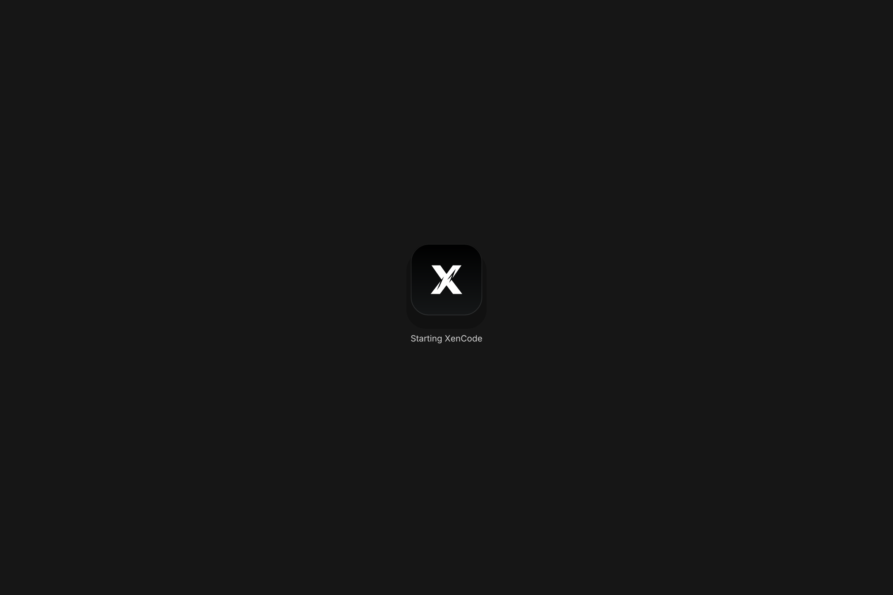
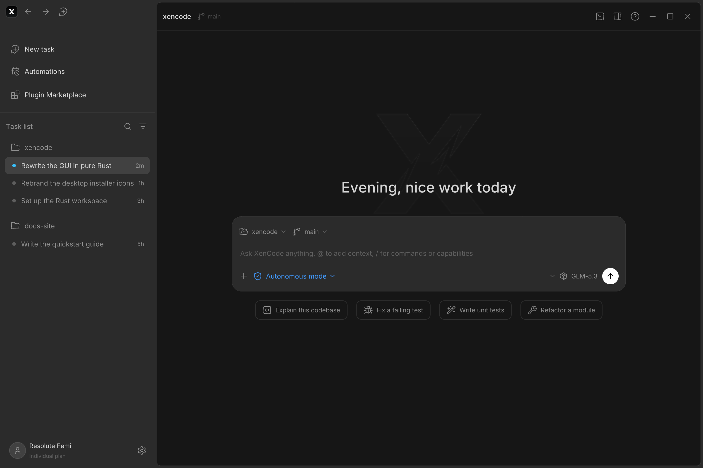
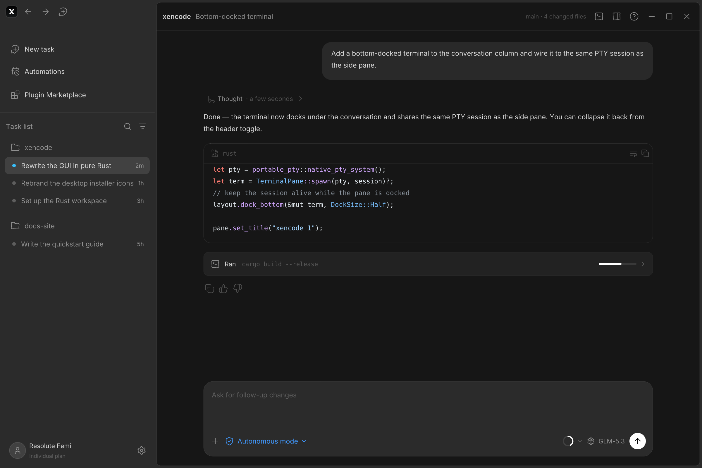
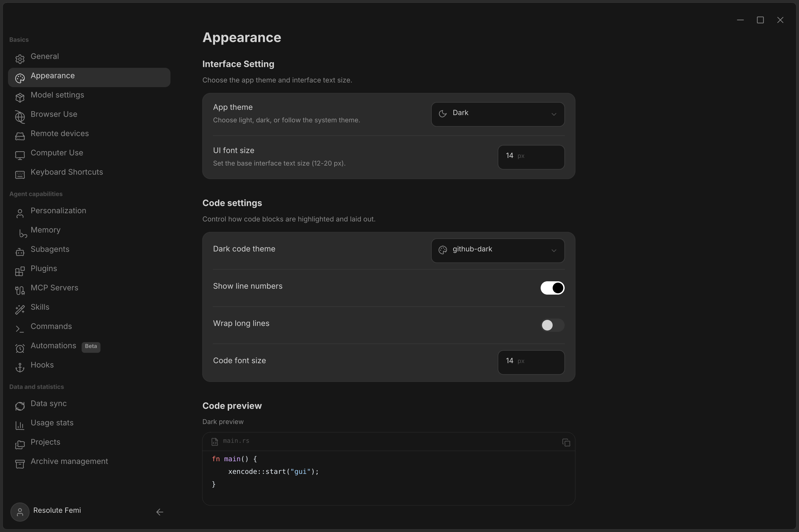
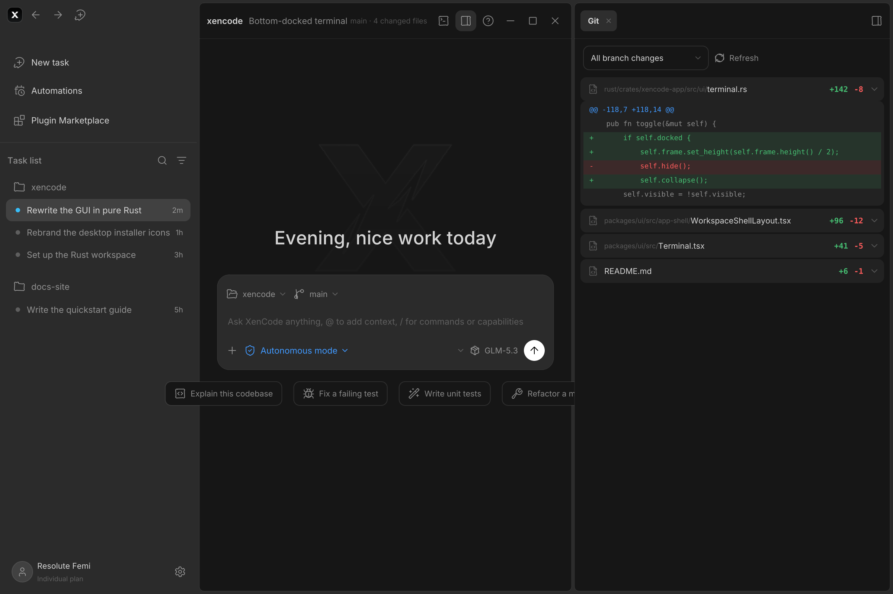
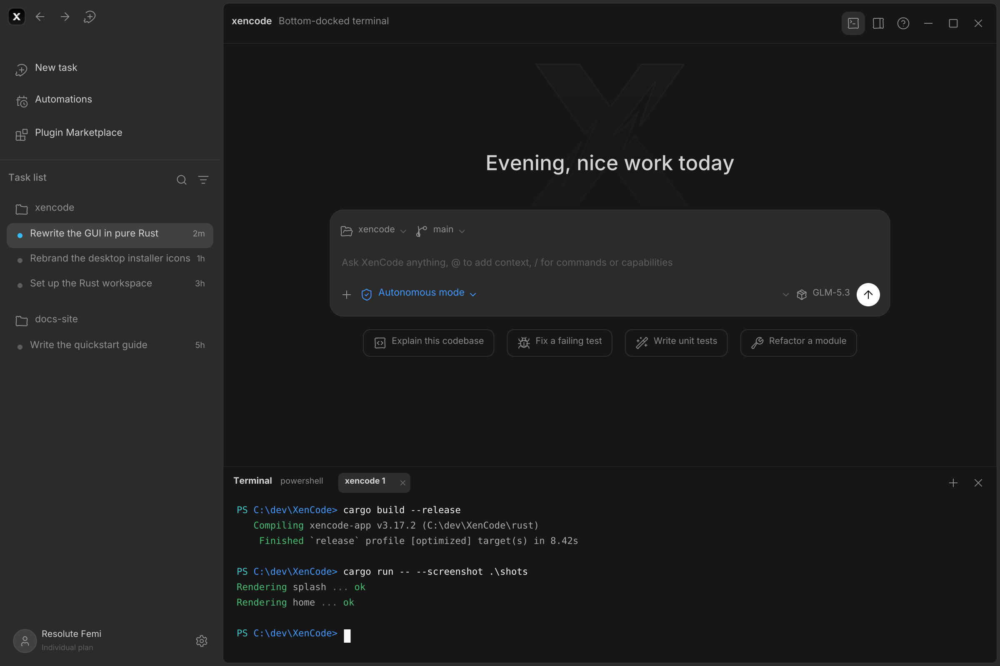

<h1 align="center">XenCode</h1>

<p align="center">
  
</p>

<p align="center">
  A <b>100% Rust</b> coding-agent desktop app — native self-drawn GUI (no webview, no Electron)<br/>
  with a GLM-powered agent core and a QuickJS automation engine (no Python).
</p>

> **Status:** active development. The GUI is a pixel-faithful reimplementation of the ZCode v3.17.2 UX (all six primary pages rendered and verified). The agent core (Phase 1) runs headlessly today; the QuickJS automation engine, **XenBrowser** (embedded agent browser) and **XenRE** (decompiler suite) are next — see [plan.md](plan.md).

## Highlights

- 🦀 **Native GUI** — software-rasterized in pure Rust (tiny-skia + ab_glyph); zero web technology in the render path
- 🤖 **Agent core** — GLM streaming, tool execution (read / write / edit / list / grep / bash / todo), JSON sessions, permission gates
- 📸 **Visual ground truth** — every GUI page can be rendered to PNG headlessly via `--screenshot`
- ⚡ **QuickJS automation (next)** — capability-scoped `xen.*` scripting, ~4 ms boot, one static binary
- 🌐 **XenBrowser & XenRE (roadmap)** — embedded agent browser with Spaces; decompiler toolkit for APK / IPA / XEX / ELF / PE

## Screenshots

| Splash | Home |
| --- | --- |
|  |  |
| **Chat** | **Appearance settings** |
|  |  |
| **Git pane** | **Terminal dock** |
|  |  |

## Build & run

Requires a stable [Rust](https://rustup.rs) toolchain.

```bash
cd app
cargo build --release
./target/release/xencode --screenshot --out shots   # render every GUI page to PNG
```

Live window mode (winit + softbuffer) is the next GUI milestone.

## Headless agent

```bash
export XENCODE_API_KEY=...        # your z.ai API key
export XENCODE_MODEL=glm-4.6      # optional (default: glm-4.6)
export XENCODE_BASE_URL=...       # optional (default: https://api.z.ai/api/paas/v4)

cd your-project
xencode --agent "Explain this codebase"
```

The agent streams its answer to stdout, executes tools inside the working
directory (gated by a permission policy), and saves the transcript under
`.xencode/sessions/`.

## Repository layout

```
app/          the entire Rust application (GUI + agent core)
  src/ui/     native renderer pages (shell, sidebar, splash, chat, settings…)
  src/agent/  provider clients, tools, agent loop, sessions, permission gates
public/       brand assets
screenshots/  rendered GUI pages (visual ground truth)
plan.md       master build plan — phases 0–8
```

## License

Apache-2.0 — see [LICENSE](LICENSE).
